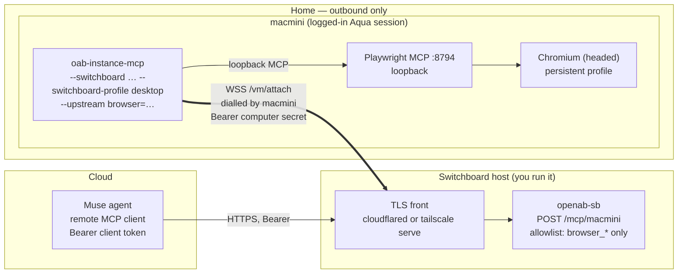

# Reference architecture — an agent drives the browser on a computer at home

This page wires three pieces together so that a cloud agent (Muse is the example) can use
the **browser on a computer at home** — a Mac mini, for instance — through `openab-sb`:

```
Muse (cloud agent)  ──HTTPS + Bearer──►  openab-sb  ◄──WSS (home dials out)──  macmini
                                         switchboard                            oab-instance-mcp
                                                                                + Playwright MCP
                                                                                + Chromium
```

It is a reference, not a requirement. Everything it relies on is described in
[`README.md`](../README.md), [`SOUTHBOUND-CONTRACT.md`](SOUTHBOUND-CONTRACT.md) and
[`adr/multi-computer.md`](adr/multi-computer.md); this page only shows how they fit for one
use case.

## Why this shape

The agent and the home computer cannot reach each other:

- The home computer has no inbound port and is not reachable from the agent's network.
- The agent runs in the cloud and cannot enter the home network.

Both can dial out. So the home computer dials the switchboard (southbound), the agent calls
the switchboard (northbound), and the switchboard relays MCP between them. Nothing at home
listens for the agent.

**Why the home browser rather than the agent's own.** A tool call is executed on the home
computer, so the browser it drives:

- leaves from the home **residential IP**, not a cloud address;
- has the home browser profile's **cookies and logged-in sessions**.

That is the benefit, and also the risk — see [Trust and risk](#trust-and-risk).

## Roles

Muse appears in two different roles in this repository. Do not mix them up:

| Role | What it is | Direction | Where it is configured |
|---|---|---|---|
| **Computer** (`muse-vm`) | A Muse Secure VM that is *controlled*, running `sb_daemon.py` | dials `/vm/attach` | `[[computer]]` |
| **Caller** (this page) | Muse the agent that *controls* a computer | calls `POST /mcp/<computer>` | `[[client]]` |

This page is about Muse as a **caller** and the Mac mini as the **computer**.

## Components



| Piece | Runs on | Job |
|---|---|---|
| Muse | cloud | MCP client. Needs to add a remote MCP server by URL with an `Authorization` header |
| TLS front | switchboard host | Terminates TLS. `cloudflared` when Muse is outside your tailnet; `tailscale serve` only if Muse is on it |
| `openab-sb` | switchboard host | Authenticates, picks the computer from the path, applies the per-caller tool allowlist, relays |
| `oab-instance-mcp` | macmini | Dials the switchboard, serves tools on that socket under one profile |
| Playwright MCP | macmini | Loopback MCP server driving the browser (`poc/pw-mcp` in instance-mcp) |
| Chromium | macmini | The browser, with the persistent profile |

## Call flow

1. `oab-instance-mcp` dials `wss://<switchboard>/vm/attach` with the computer secret. The
   switchboard picks the slot from the secret and sends `initialize`.
2. Muse calls `POST https://<switchboard>/mcp/macmini` with its client token.
3. The switchboard resolves, in order, the token, then the computer, then the tool. A tool
   outside the allowlist is absent from `tools/list` and refused on `tools/call`.
4. Allowed calls are relayed down the computer's socket. `oab-instance-mcp` filters again by
   its own profile and forwards `browser_*` calls to the Playwright MCP upstream on loopback.
5. Chromium acts from the home network and replies travel back the same way.

While the Mac is offline, Muse gets the tool error "the VM is not connected" and still finds
the switchboard (`/healthz` is 200).

## Setup

### 1. Switchboard

```sh
openab-sb gen-secret     # once for the computer  → secret (macmini) + verifier
openab-sb gen-secret     # once for the caller    → token  (Muse)    + verifier
```

`openab-sb.toml`:

```toml
[[computer]]
name = "macmini"
secret_sha256 = "sha256:…"            # verifier of the macmini secret

[[client]]
name = "muse"
token_sha256 = "sha256:…"             # verifier of Muse's token
default_computer = "macmini"
computers = { macmini = [
  "sys_info",
  "browser_navigate", "browser_navigate_back", "browser_snapshot", "browser_find",
  "browser_click", "browser_type", "browser_fill_form", "browser_press_key",
  "browser_hover", "browser_select_option", "browser_wait_for", "browser_tabs",
  "browser_take_screenshot", "browser_console_messages", "browser_resize",
] }
max_inflight = 2
```

The list above is the instance-mcp `desktop` browser set
(`ToolProfile.desktopBrowserTools`) plus `sys_info`. Trim it further if the task allows.
Deliberately **absent**: `mouse`, `key`, `osascript`, `exec*`, `screenshot` of the whole
desktop. Then `openab-sb check -c openab-sb.toml` and `openab-sb serve -c openab-sb.toml`.
Put TLS in front — see [Exposing the switchboard](#exposing-the-switchboard).

### 2. Mac mini

Install the Playwright MCP upstream (`poc/pw-mcp/install.sh` in instance-mcp), then give
`oab-instance-mcp` the switchboard URL, the computer secret and the upstream:

```sh
oab-instance-mcp --token-file ~/.config/oab-instance-mcp/token \
  --upstream browser=http://127.0.0.1:8794/mcp \
  --switchboard wss://<switchboard>/vm/attach \
  --switchboard-secret-file ~/.config/oab-instance-mcp/switchboard.secret \
  --switchboard-profile desktop
```

Why `desktop`: `observe` serves `sys_info` and `screenshot` only, with no browser tools.
`owner` adds shell and arbitrary-JavaScript browser tools. `desktop` is the smallest profile
that carries the 15 browser tools. It *also* carries `mouse`, `key` and `osascript` on the
computer, which is why the switchboard allowlist above is what keeps Muse to the browser.

With the packaged installer, put the URL, secret and profile in
`~/.config/oab-instance-mcp/switchboard.{url,secret,profile}` and re-run the installer.

### 3. Muse

Add a remote MCP server with:

- URL `https://<switchboard>/mcp/macmini`
- header `Authorization: Bearer <Muse token>`

Muse must support Streamable HTTP MCP and a custom header. Whether and how a given Muse
deployment allows that is outside this repository.

### 4. Verify

```sh
# 1. computer attached and ready
curl -s -H "Authorization: Bearer $MUSE_TOKEN" https://<switchboard>/readyz/macmini -o /dev/null -w '%{http_code}\n'   # 200

# 2. what Muse can see: expect sys_info + the browser_* names, and no mouse/key/exec
curl -s -H "Authorization: Bearer $MUSE_TOKEN" -H 'Content-Type: application/json' \
  -H 'Accept: application/json, text/event-stream' \
  -d '{"jsonrpc":"2.0","id":1,"method":"tools/list"}' https://<switchboard>/mcp/macmini

# 3. a forbidden tool must read as unknown
#    tools/call name=mouse  → unknown tool
```

Then have Muse call `browser_navigate` to an IP-echo page and compare with your home
address, and open a site the profile is logged in to.

## Exposing the switchboard

`openab-sb` binds loopback and needs TLS in front.

- Muse **inside** your tailnet: `tailscale serve --bg https / http://127.0.0.1:8790`.
- Muse **outside** your tailnet (the usual case for a cloud agent): a public tunnel such as
  `cloudflared`. The bearer tokens are then the only gate, so keep the generated 256-bit
  tokens, rotate with `SIGHUP`, and keep the allowlist narrow.
- If Muse only reaches approved addresses, that address is the switchboard's front.

## Trust and risk

- **The browser profile is lent whole.** Muse can act as any account logged in to that
  Chromium profile. Use a **dedicated profile** logged in only to what the task needs, not
  your daily browser.
- **The allowlist is policy, not isolation.** It narrows what Muse may *call*; it does not
  narrow the browser. The computer is still an unrestricted desktop user, and `mouse`/`key`/
  `osascript` are hidden from Muse by the allowlist only. The computer's profile remains the
  ceiling and the caller gets the intersection.
- **Prompt injection.** Page text and screenshots go into Muse's context. A hostile page can
  try to steer an agent that holds your sessions. Treat browser output as untrusted.
- **Network reach.** The browser reaches whatever the Mac reaches, including localhost and the
  home LAN. Put the Mac on a network segment you are willing to expose, or use a dedicated
  machine.
- **The switchboard holds both sides' credentials.** Run it only on a host you trust. It
  stores only `sha256:` verifiers.
- **Public exposure.** With a public tunnel there is no tailnet identity check, only tokens.

## Limits of this reference

- **macOS only today for `--switchboard`.** In instance-mcp `main`, `--switchboard` exists in
  the Swift daemon. The Linux Rust hands node (`poc/reverse-attach-linux`) has no switchboard
  mode, so a Raspberry Pi or mini PC would need a daemon that follows
  [`SOUTHBOUND-CONTRACT.md`](SOUTHBOUND-CONTRACT.md) (see `examples/muse-daemon/sb_daemon.py`)
  and its own browser tooling.
- **No browser-only profile yet.** `desktop` still includes GUI tools; instance-mcp tracks a
  narrower browser tier in its #45. Until then the switchboard allowlist is the control.
- **One socket per computer.** A second daemon with the same secret evicts the first (`4002`).
- **Not verified here:** this page was assembled from the repository documents and source,
  not from an end-to-end run with Muse. Run the checks in [Verify](#4-verify) before relying
  on it.
